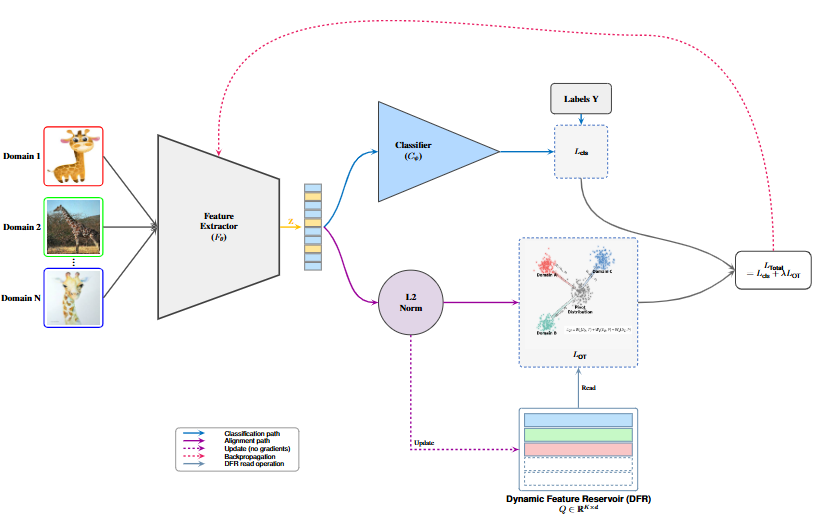
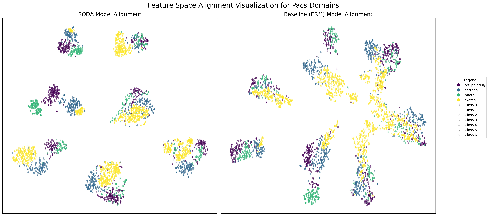

# SODA: Stabilized Optimal Transport Based Domain Alignment for Domain Generalization via a Dynamic Feature Reservoir

## Requirements

- Python 3.9.7
- numpy 1.20.3
- torch 1.11.0
- torchvision 0.12.0

Figure 1: An overview of the proposed SODA framework. During a training step, images from multiple source domains are passed through a shared feature extractor Fθ. The resulting features Z are used in two parallel paths: (1) a supervised classification path (solid blue line) that computes the standard cross-entropy loss Lcls, and (2) a stabilized alignment path (solid purple line). In the alignment path, features are L2-normalized and aligned to the Dynamic Feature Reservoir (DFR) using an Optimal Transport loss, LOT. The DFR is a high-capacity feature queue that acts as a stable, synthetic pivot distribution. The total loss is backpropagated to update the model (dashed red line). Finally, in a gradient-free step, the DFR is updated with the new, normalized features from the current batch (dashed purple line).

Figure 2: t-SNE visualization of the ResNet-50 feature space on the PACS dataset with Art as the unseen target domain. Points are colored by their domain and numbered by their class label. (a) The baseline ERM model exhibits strong domain-based clustering, indicating a failure to learn invariant features. (b) Our SODA method successfully aligns the domains, resulting in distinct class-based clusters where features from all domains are intermingled.

## Dataset

Firstly, create a directory for output files and change the dataset path and output path.

# Download the datasets:

python3 -m domainbed.scripts.download \
       --data_dir=./domainbed/data

## Training / Testing

To train, you can run the command:
`
# Run your program
python3 -m domainbed.scripts.sweep launch\
       --output_dir=./PathToOutput/ \
       --command_launcher multi_gpu\
       --algorithms SODA \
       --datasets DATASET \
       --n_hparams 100 \
       --n_trials 3 \
       --skip_confirmation \
       --data_dir=./domainbed/data/ \
       --single_test_envs \

python -m domainbed.scripts.sweep delete_incomplete\
       --output_dir=./PathToOutput/ \
       --command_launcher multi_gpu\
       --data_dir=./domainbed/data/ \
       --skip_confirmation \

python -m domainbed.scripts.collect_results\
       --input_dir=./PathToOutput/
`

## Acknowledgement

Part of our code is borrowed from the following repositories.
- DomainBed [https://github.com/facebookresearch/DomainBed]

We thank the authors for releasing their codes. Please also consider citing their works.
